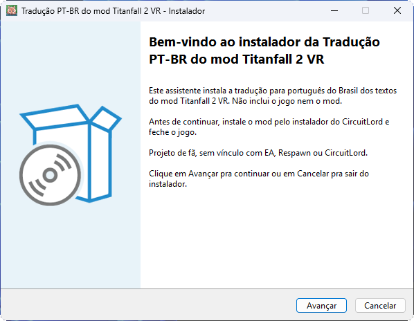
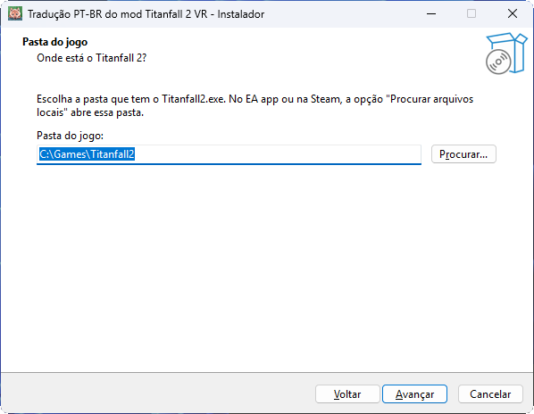
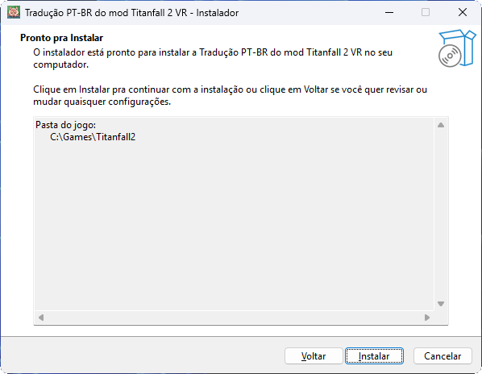
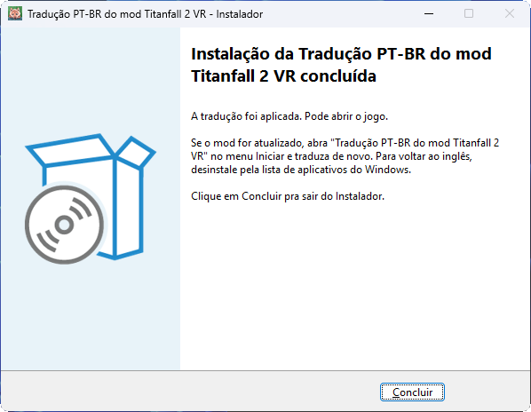
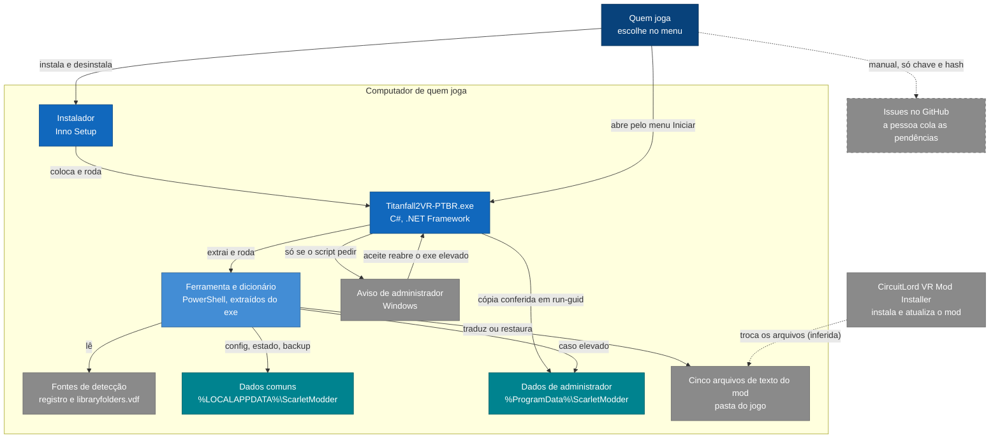
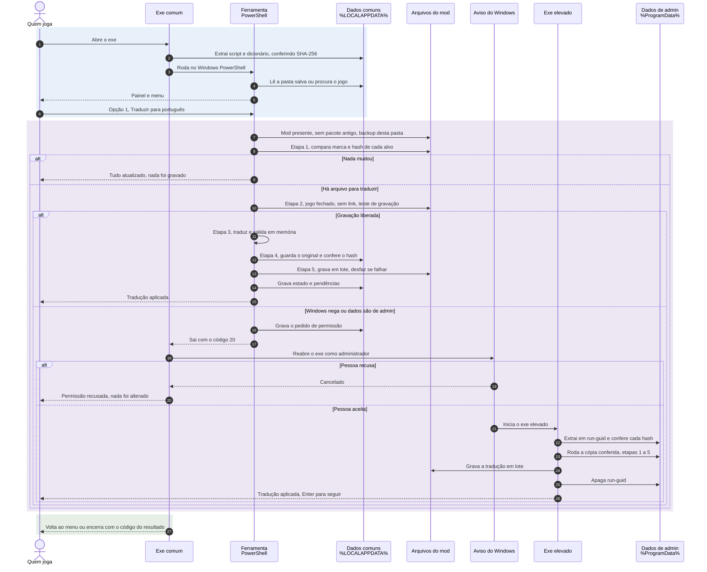
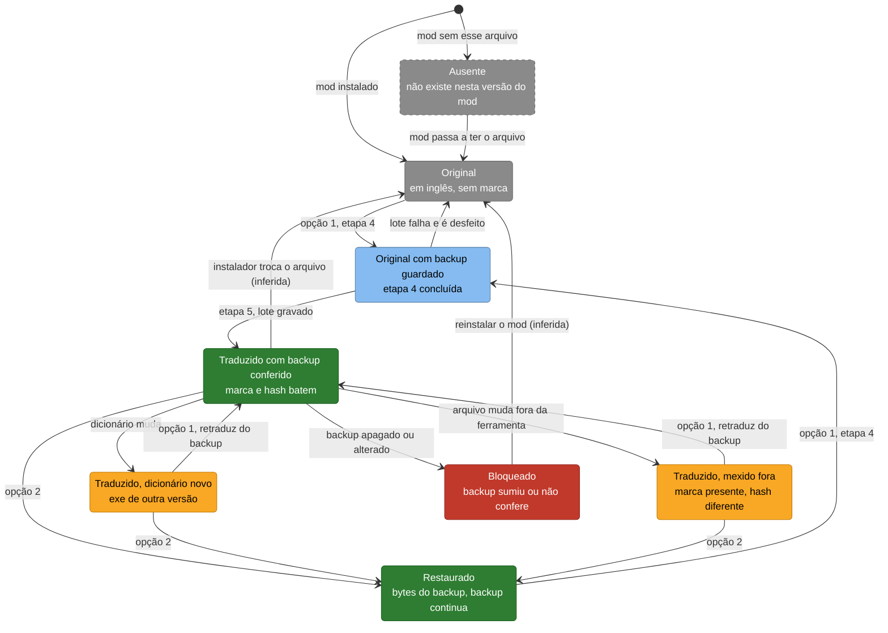

<picture>
  <source media="(prefers-color-scheme: dark)" srcset="docs/images/banner-dark.svg">
  
</picture>

# 🎮 Tradução PT-BR do mod Titanfall 2 VR

**Os textos do mod Titanfall 2 VR em português do Brasil. Não inclui o jogo nem o mod: você baixa o instalador, clica em Avançar e a tradução entra sozinha.**

[Como instalar](#-como-instalar) · [Guia completo](docs/installation.md) · [Baixar](https://github.com/scarletmodder/titanfall2-vr-ptbr/releases/latest) · [Changelog](CHANGELOG.md)

**Neste documento:** [Como instalar](#-como-instalar) · [Por que existe](#-por-que-existe) · [O que muda](#-o-que-muda) · [Uso](#-uso) · [Segurança](#-segurança-e-privacidade) · [Como funciona](#%EF%B8%8F-como-funciona) · [Problemas comuns](#-problemas-comuns) · [Estado](#%EF%B8%8F-estado-atual)

## 🚀 Como instalar

Você precisa do Titanfall 2 com o [mod VR do CircuitLord](https://github.com/CircuitLord/CircuitLordVRModInstaller) já instalado. Este instalador coloca só a tradução. Depois:

1. **Baixe** o `Instalador-Traducao-PTBR-Mod-Titanfall2VR-v<versão>.exe` na [página de downloads](https://github.com/scarletmodder/titanfall2-vr-ptbr/releases/latest).
2. **Feche o jogo** e abra o arquivo baixado com dois cliques.
3. **Clique em Avançar**, confira a pasta do jogo e clique em **Instalar**. Na última tela, a mensagem é "A tradução foi aplicada. Pode abrir o jogo."

| 1. Boas-vindas | 2. Pasta do jogo |
|---|---|
|  |  |
| **3. Pronto para instalar** | **4. Concluído** |
|  |  |

A pasta que aparece nas capturas é um exemplo. Na sua máquina, o instalador procura o jogo sozinho e você pode trocar a pasta.

Para voltar ao inglês, desinstale "Tradução PT-BR do mod Titanfall 2 VR" pela lista de aplicativos do Windows.

> [!TIP]
> O passo a passo com cada mensagem, a desinstalação e a lista de problemas estão no [guia de instalação](docs/installation.md).

## 🎯 Por que existe

Em VR, o que o mod escreve na tela é o que ensina qual botão apertar e onde: o menu de configurações, os avisos de interação, as dicas do tutorial, o botão de equipamento do Titã e as escolhas de diálogo. Tudo isso vem em inglês. Fiz esta tradução porque acredito que podemos jogar em português sem redistribuir nada do mod nem do jogo.

Ela faz parte do ecossistema do [mod Titanfall 2 VR do CircuitLord](https://github.com/CircuitLord/CircuitLordVRModInstaller), que precisa estar instalado antes. Este é um projeto de fã, sem vínculo com o autor do mod, com a EA ou com a Respawn.

Para você, o ganho é direto: um instalador pequeno acha o mod e troca só os textos em inglês. Ao desinstalar, os originais voltam idênticos byte a byte.

Para a versão 1.0.25 do mod são **196 textos traduzidos e nenhum pendente**, conferidos no mod instalado. Cada arquivo publicado tem o hash (a impressão digital do arquivo) no `SHA256SUMS.txt` da release.

## ✨ O que muda

A ferramenta nunca toca no jogo base. Só os textos do mod mudam.

**Antes:** o menu de configurações de VR, os avisos de interação, as dicas do tutorial, o botão de equipamento do Titã e as escolhas de diálogo aparecem em inglês.

**Depois:** os mesmos textos aparecem em português, dizendo qual botão apertar e onde. Um exemplo escrito no projeto: "Segure o grip no quadril esquerdo para sacar a segunda arma".

**Traduzir** 
Troca os textos em inglês dos arquivos do mod pela tradução, depois de guardar uma cópia do original. ✅ pronto

**Voltar ao inglês** 
Devolve os arquivos exatamente como estavam antes da tradução. ✅ pronto

**Atualizar com o mod** 
O instalador do mod desfaz a tradução a cada atualização. Abra "Tradução PT-BR do mod Titanfall 2 VR" no menu Iniciar e escolha a opção `[1]`: se nada mudou, a ferramenta avisa e não grava nada. ✅ pronto

**Desinstalar pela lista de aplicativos** 
O instalador cria a entrada "Tradução PT-BR do mod Titanfall 2 VR" na lista do Windows. Desinstalar por lá devolve os originais e apaga os dados da ferramenta. ✅ pronto (a desinstalação foi conferida abrindo o desinstalador direto; o clique pela página de aplicativos do Windows ainda não)

**Dicionário sem texto do mod** 
Ele guarda só o hash do texto em inglês e a tradução. A linha real vem do mod instalado no seu computador. ✅ pronto

## 🧭 Uso

| Eu quero | O que faço | O que acontece |
|---|---|---|
| Traduzir | Rodo o instalador até o fim | O mod fica em português e o original vai para um backup |
| Voltar ao inglês | Abro o programa no menu Iniciar e escolho `[2] Voltar aos textos originais (inglês)` | Os arquivos voltam byte a byte ao que eram |
| Trocar a pasta do jogo | No programa, escolho `[3] Trocar a pasta do jogo` | O programa procura de novo ou pede a pasta com o `Titanfall2.exe` |
| Atualizar depois do mod | No programa, escolho `[1]` de novo | Se nada mudou, aparece "Tudo atualizado" e nada é gravado |
| Remover tudo | Configurações do Windows, Aplicativos, Aplicativos instalados | Os originais voltam e os dados da ferramenta são apagados |

Se o mod atualizar e trouxer texto novo, esse texto fica em inglês e o resto continua traduzido. O programa mostra uma lista pronta para colar numa [issue](https://github.com/scarletmodder/titanfall2-vr-ptbr/issues) (um aviso aberto no GitHub), só com chave e hash, sem texto do mod.

## 🔒 Segurança e privacidade

- **Sem internet.** O programa não baixa nem envia nada.
- **Só os textos do mod.** Ele grava em cinco arquivos de texto do próprio mod, nunca no jogo base, e antes guarda uma cópia do original.
- **Backup conferido.** Antes de usar o backup, o programa compara o hash dele com o registrado na criação. Se não bater, não grava.
- **Nunca grava com o jogo aberto.** Se a gravação falhar, os arquivos voltam ao estado de antes daquela execução.
- **Sem pedir administrador para instalar.** O instalador grava só na sua pasta de usuário. Se o Windows pedir essa permissão para gravar na pasta do jogo, a escolha é sua, e recusar não altera nada.
- **Instalador sem assinatura digital.** O Windows pode avisar que o arquivo é desconhecido. Você pode conferir o hash do arquivo ou compilar pelo código com `scripts\build.ps1`. Veja [como conferir](docs/installation.md#2-conferir-o-arquivo-opcional).
- **Antivírus.** Alguns antivírus podem alertar por ser um executável sem assinatura digital, de projeto aberto. É um falso positivo. Veja [o que fazer nesse caso](docs/installation.md#%EF%B8%8F-alerta-do-antivírus).

## 🏗️ Como funciona

O instalador coloca um programa pequeno na sua pasta de usuário e o roda para aplicar a tradução. Esse programa carrega dentro de si a ferramenta em PowerShell e o dicionário, roda no seu computador, não fala com servidor nenhum e só mexe nos arquivos de texto do mod.

**Contexto: com quem o programa conversa no seu computador.**

As linhas tracejadas marcam o que o código não controla: a ação manual de abrir uma issue e o que o instalador do mod faz, que se infere porque ele tem código fechado.

Sequência da opção Traduzir e estados de um arquivo do mod

**Sequência: o que acontece, em ordem, quando a tradução é aplicada, pelo instalador ou pela opção 1 do programa.**

**Estados: por onde cada um dos cinco arquivos de texto do mod passa.**

As duas transições marcadas "(inferida)" dependem do instalador do mod, que tem código fechado.

Para quem contribui: as regras do dicionário estão em [tool/translations/RULES.md](tool/translations/RULES.md) e o processo, em [CONTRIBUTING.md](CONTRIBUTING.md).

## 🩺 Problemas comuns

| Sintoma na tela | Causa provável | O que fazer |
|---|---|---|
| `O Titanfall 2 está aberto.` | O jogo está rodando | Feche o jogo e tente de novo |
| `O mod Titanfall 2 VR não está instalado nesta pasta.` | A pasta escolhida não tem o mod | Escolha `[3]` e indique a pasta certa, ou instale o mod antes |
| `Este jogo tem um pacote antigo de tradução instalado ("Titanfall 2 VR em Português").` | O pacote antigo altera os mesmos arquivos | Desinstale em Configurações do Windows, Aplicativos, e rode de novo |
| `O arquivo ... está aberto em outro programa.` | O EA app, a Steam ou o instalador do mod estão verificando o jogo | Espere terminarem e tente de novo |
| `Nem como administrador o Windows deixou gravar em ...` | O arquivo está marcado como somente leitura | Botão direito no arquivo, Propriedades, desmarque "Somente leitura" |
| `N texto(s) do mod ainda não têm tradução e aparecem em inglês no jogo.` | O mod atualizou e trouxe texto novo | Pode jogar. Para ajudar, cole a lista numa issue |

> [!WARNING]
> Apagar a pasta de dados da ferramenta com o jogo ainda traduzido perde a cópia do original. Use a desinstalação pela lista de aplicativos do Windows, que devolve os originais antes de apagar.

Mais casos, como a recusa de abrir de dentro de outro aplicativo, estão no [guia de instalação](docs/installation.md#-problemas-comuns).

## 🗺️ Estado atual

| Área | Estado | Como foi conferido |
|---|---|---|
| Tradução dos textos do mod 1.0.25 | ✅ pronto | 196 textos traduzidos e nenhum pendente, no mod instalado, e jogo testado no headset |
| Voltar ao inglês | ✅ pronto | O backup de cada arquivo tem hash igual ao do original, e os testes automáticos provam a restauração |
| Instalador com telas | ✅ pronto | Testes automáticos e uma instalação pelas telas num computador real, sem pedido de permissão e com os 5 arquivos traduzidos conferidos |
| Antivírus no instalador | ⚠️ medido em uma máquina | Microsoft Defender sem nenhum alerta 54 minutos depois de instalar |
| Desinstalar | ✅ pronto | Testes automáticos e uma desinstalação real, com o desinstalador aberto direto: os 5 arquivos voltaram idênticos aos originais, e programa, dados, atalho e entrada saíram |
| Tela inicial de calibração dos braços | ⚠️ continua em inglês | As frases dessa tela são uma imagem do mod, não um arquivo de texto |
| Aparência dentro do headset | ✅ pronto | Jogo testado no headset, sem problema no conteúdo em PT-BR |
| Aviso de administrador do Windows | ⚠️ só simulado | Os testes automáticos simulam o aviso |

Se algo sair errado na tela do jogo, abra uma [issue](https://github.com/scarletmodder/titanfall2-vr-ptbr/issues) dizendo em qual tela apareceu.

## 📚 Documentação

| Documento | O que tem |
|---|---|
| [Guia de instalação](docs/installation.md) | Passo a passo, desinstalação, onde ficam os dados e problemas comuns |
| [Regras do dicionário](tool/translations/RULES.md) | Como a tradução é escrita e conferida |
| [Como contribuir](CONTRIBUTING.md) | Testes, padrões e o que nunca entra |
| [Changelog](CHANGELOG.md) | O que mudou em cada versão |

## 🤝 Contribuição

Correção de tradução e aviso de texto novo são as contribuições mais úteis. Abra uma issue pelo modelo certo ([problema](.github/ISSUE_TEMPLATE/problem.md) ou [texto novo](.github/ISSUE_TEMPLATE/new-text.md)) e leia o [CONTRIBUTING.md](CONTRIBUTING.md) antes de abrir um PR. Nenhum texto do mod entra em issue, commit ou PR.

## 📄 Licença

Tradução e ferramenta por Scarlet Modder, sob a licença [MIT](LICENSE), que cobre só o código e o texto deste repositório. Titanfall é marca de seus respectivos donos. O mod Titanfall 2 VR é do CircuitLord, tem código fechado e não é redistribuído aqui.
