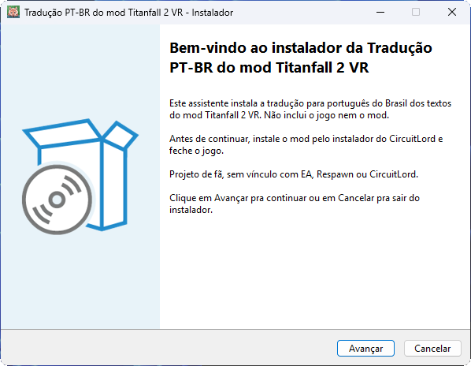
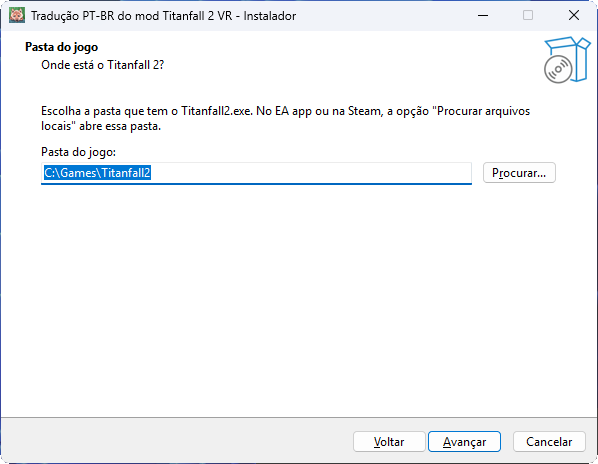
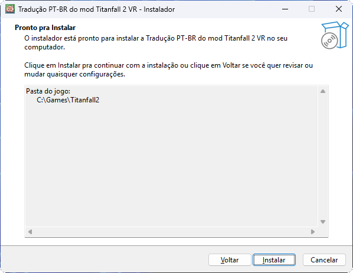
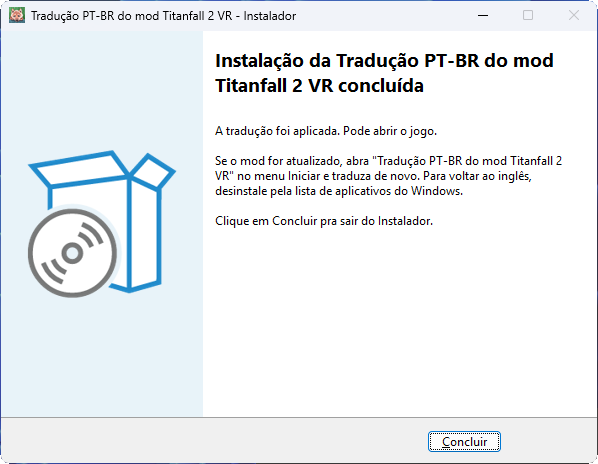
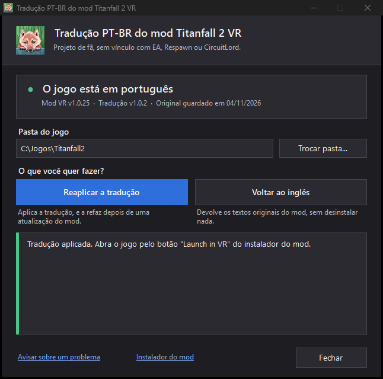
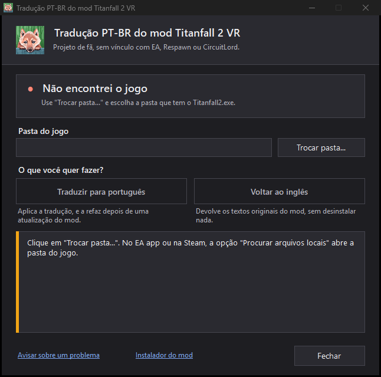
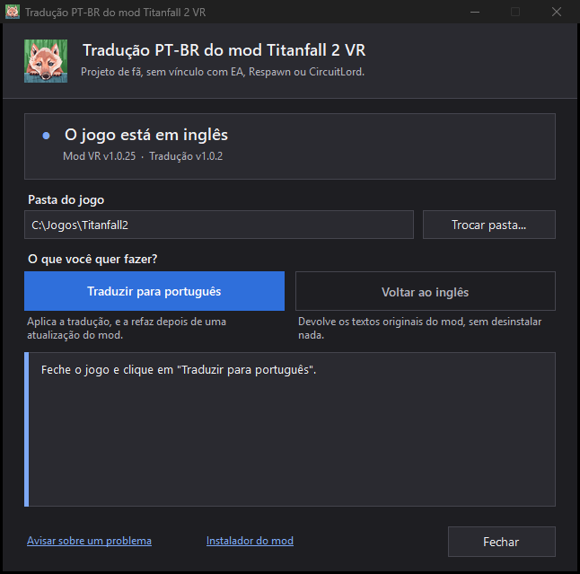
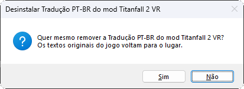
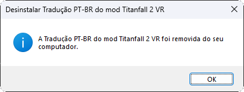

<div align="center">

<picture>
  <source media="(prefers-color-scheme: dark)" srcset="images/banner-dark.svg">
  
</picture>

# 🚀 Guia de instalação

**Do download à tradução no jogo, com as telas do instalador e a desinstalação no final.**

[Voltar ao README](../README.md) · [Instalar](#-instalar) · [O programa](#%EF%B8%8F-o-programa-do-menu-iniciar) · [Atualizar](#-atualizar-depois-de-uma-versão-nova-do-mod) · [Voltar ao inglês](#-voltar-ao-inglês) · [Desinstalar](#%EF%B8%8F-desinstalar) · [Alerta do antivírus](#%EF%B8%8F-alerta-do-antivírus) · [Problemas](#-problemas-comuns)

</div>

## 🎯 Antes de começar

Este guia é para quem quer o mod Titanfall 2 VR com os textos em português. Você vai precisar de:

- **Windows.** Conferido no Windows 11.
- **Titanfall 2 instalado.** O instalador procura o jogo na Steam, no EA app, no Origin e na Xbox ou Microsoft Store.
- **O mod VR instalado** pelo [instalador oficial do CircuitLord](https://github.com/CircuitLord/CircuitLordVRModInstaller). Sem o mod, não há o que traduzir. A tradução foi conferida contra a versão 1.0.25 do mod.

O instalador traz só a tradução: este repositório e a release não têm arquivo do jogo nem do mod.

> [!IMPORTANT]
> Se você usou o pacote antigo "Titanfall 2 VR em Português", desinstale esse pacote antes, em Configurações do Windows, Aplicativos. Ele altera os mesmos arquivos, e o programa recusa traduzir enquanto ele estiver lá.

## 🧭 O que você pode fazer

O instalador mostra as telas de boas-vindas, pasta do jogo, instalar e concluir. Depois de instalar, fica no menu Iniciar um programa chamado "Tradução PT-BR do mod Titanfall 2 VR", com uma janela para o resto.

| Quero | Onde |
|---|---|
| **Instalar** a tradução | [No instalador](#-instalar) |
| **Reaplicar** depois de uma atualização do mod | [Botão **Reaplicar a tradução** do programa, no menu Iniciar](#-atualizar-depois-de-uma-versão-nova-do-mod), ou rodando o instalador de novo |
| **Voltar ao inglês** sem desinstalar | [Botão **Voltar ao inglês** do programa](#-voltar-ao-inglês) |
| **Trocar a pasta do jogo** | [Botão **Trocar pasta...** do programa](#trocar-a-pasta-do-jogo) |
| **Desinstalar** tudo | [Lista de aplicativos do Windows](#%EF%B8%8F-desinstalar) |

## 🚀 Instalar

**Neste passo a passo:** [1. Baixar](#1-baixar) · [2. Conferir](#2-conferir-o-arquivo-opcional) · [3. Abrir](#3-abrir-o-instalador) · [4. Instalar](#4-instalar-pelas-telas) · [5. Jogar](#5-jogar)

### 1. Baixar

Abra a [página de downloads](https://github.com/scarletmodder/titanfall2-vr-ptbr/releases/latest) e baixe:

| Arquivo | O que é |
|---|---|
| `Instalador-Traducao-PTBR-Mod-Titanfall2VR-v<versão>.exe` | O instalador. É tudo de que você precisa |
| `SHA256SUMS.txt` | O hash do instalador, para conferir o download |

### 2. Conferir o arquivo (opcional)

O instalador não tem assinatura digital, que é paga. Por isso o Windows pode avisar que o arquivo é desconhecido. Para ter certeza de que o arquivo é o publicado, compare o hash dele (a impressão digital do arquivo) com o do `SHA256SUMS.txt`. No PowerShell, na pasta do download:

```powershell
Get-FileHash .\Instalador-Traducao-PTBR-Mod-Titanfall2VR-v*.exe -Algorithm SHA256
```

O resultado tem de ser igual à linha do instalador no `SHA256SUMS.txt` **da mesma release**. O hash muda a cada compilação, então não compare com o de outra versão. Se preferir não confiar em arquivo pronto, compile pelo código com `scripts\build.ps1`.

### 3. Abrir o instalador

Feche o jogo. Depois abra o arquivo baixado com dois cliques, pelo Explorador de Arquivos.

Se o Windows avisar que o arquivo é desconhecido, em "Mais informações" você pode escolher executar assim mesmo. O texto exato do aviso é do Windows e pode variar entre versões.

### 4. Instalar pelas telas

**Boas-vindas.** Clique em **Avançar**.



**Pasta do jogo.** O instalador procura o jogo sozinho e preenche a pasta. Confira, ou use **Procurar...** para escolher a pasta que tem o `Titanfall2.exe`. No EA app ou na Steam, a opção "Procurar arquivos locais" abre essa pasta. Clique em **Avançar**.



*A pasta das capturas é um exemplo.*

Se faltar algo, o instalador avisa antes de continuar: "Não achei o Titanfall2.exe nesta pasta" ou "O mod Titanfall 2 VR não está instalado nesta pasta".

**Pronto para instalar.** Clique em **Instalar**.



**Concluído.** O instalador coloca o programa, aplica a tradução e mostra "A tradução foi aplicada. Pode abrir o jogo." Clique em **Concluir**.



> [!NOTE]
> Se a pasta do jogo for protegida, o Windows pode pedir permissão de administrador para gravar nela. A escolha é sua. Se você recusar, o programa fica instalado, a tradução não é aplicada e o instalador avisa na última tela. Esse aviso do Windows só foi simulado nos testes.

### 5. Jogar

Abra o jogo pelo botão "Launch in VR" do instalador do mod, como o próprio programa lembra: "Próximo passo: abra o jogo pelo botão "Launch in VR" do instalador do mod."

Se o instalador do mod estiver aberto durante a tradução, o programa avisa: "O instalador do mod está aberto. Se ele atualizar o mod, rode esta ferramenta de novo depois."

## 🖥️ O programa do menu Iniciar

Abra **"Tradução PT-BR do mod Titanfall 2 VR"** no menu Iniciar. A janela mostra em que idioma o jogo está, a pasta do jogo e os botões. A área de baixo diz o que aconteceu depois de cada clique.



*A pasta das capturas é um exemplo.*

### Trocar a pasta do jogo

Clique em **Trocar pasta...** e escolha a pasta que tem o `Titanfall2.exe`. No EA app ou na Steam, a opção "Procurar arquivos locais" abre essa pasta. A janela confere a pasta escolhida e mostra a situação dela.

Se o programa não achar o jogo sozinho, a janela avisa e só esse botão fica ligado:



## 🧭 Atualizar depois de uma versão nova do mod

O instalador do mod troca os arquivos a cada atualização, e a tradução some. Abra o programa no menu Iniciar e clique em **Reaplicar a tradução**. Se a tradução tiver sumido por inteiro, o botão se chama **Traduzir para português**.

- **Nada mudou:** a janela avisa "A tradução já estava aplicada e nada mudou: nenhum arquivo foi alterado."
- **O mod mudou:** o programa guarda o novo original como backup e traduz de novo.
- **Texto novo no mod:** ele fica em inglês e o resto continua traduzido. A janela mostra "N texto(s) do mod ainda não têm tradução e aparecem em inglês no jogo." e o botão **Copiar textos sem tradução**, com uma lista pronta para colar numa [issue](https://github.com/scarletmodder/titanfall2-vr-ptbr/issues) (um aviso aberto no GitHub), só com chave e hash de cada texto.

O jogo já pode ser aberto com texto novo em inglês. Para a tradução entrar na versão seguinte, abra a issue com a lista.

## 🔄 Voltar ao inglês

Abra o programa no menu Iniciar e clique em **Voltar ao inglês**. Os arquivos voltam a ser exatamente os que estavam antes da tradução, e a janela confirma. Para traduzir de novo, clique em **Traduzir para português**.



Se não houver nada traduzido, o botão **Voltar ao inglês** fica desligado.

## 🗑️ Desinstalar

A desinstalação é feita pela lista de aplicativos do Windows.

1. Feche o jogo.
2. Abra **Configurações**, **Aplicativos**, **Aplicativos instalados**.
3. Procure **"Tradução PT-BR do mod Titanfall 2 VR"** (editora "Scarlet Modder") e escolha desinstalar.
4. Confirme com **Sim**.

   

5. Quando terminar, aparece esta caixa. Clique em **OK**.

   

A desinstalação devolve os textos originais do mod, apaga os dados da ferramenta, o programa e a própria entrada da lista. A desinstalação foi conferida num computador real abrindo o desinstalador direto; o clique pela página de aplicativos do Windows ainda não. Se você traduziu como administrador, o programa está feito para pedir a permissão de novo e limpar a pasta de administradores, mas isso ainda não foi visto numa máquina real.

O instalador que você baixou não é apagado: mandar o arquivo para a Lixeira é com você.

<details>
<summary>Casos especiais da desinstalação</summary>

| Situação | O que acontece |
|---|---|
| O jogo está aberto | Os originais não voltam. Aparece "Não consegui devolver os textos originais." Escolha **Não**, feche o jogo e desinstale de novo |
| O jogo foi desinstalado antes | Os originais não têm para onde voltar. Na mesma caixa, escolha **Sim** para remover só esta ferramenta |
| Algo falhou no meio | Aparece "A desinstalação não terminou e nada foi removido." A entrada continua na lista, e você pode tentar de novo |
| O antivírus levou o programa | Aparece "Não consegui abrir o programa da tradução". Escolha **Sim** para tirar o programa da lista. A cópia dos originais continua guardada: para voltar ao inglês depois, instale de novo e desinstale |

</details>

> [!WARNING]
> Não apague a pasta de dados com o jogo ainda traduzido: a cópia dos originais mora lá, e sem ela só reinstalar o mod devolve o inglês.

## 🛡️ Alerta do antivírus

Alguns antivírus podem alertar por ser um executável sem assinatura digital, de projeto aberto. É um falso positivo: o programa faz só o que está no código aberto deste repositório.

Num computador real, o instalador foi usado e ficou 54 minutos sem nenhum alerta. É a medida de uma máquina só. Você pode [conferir pelo hash que o arquivo é o publicado, ou compilar pelo código](#2-conferir-o-arquivo-opcional).

**Se o alerta aparecer:** o programa vai para a quarentena. A tradução que já foi aplicada continua no jogo, e a entrada "Tradução PT-BR do mod Titanfall 2 VR" pode continuar na lista. Desinstalar por ela mostra o aviso "Não consegui abrir o programa da tradução".

**Para voltar ao original nesse caso:**

1. Feche o jogo.
2. Reinstale o mod pelo [instalador do CircuitLord](https://github.com/CircuitLord/CircuitLordVRModInstaller).
3. Abra o jogo e confira se os textos voltaram ao inglês.
4. Só se tiverem voltado, apague a pasta `%LOCALAPPDATA%\ScarletModder\Titanfall2VR-PTBR`. Se você traduziu como administrador, apague também `%ProgramData%\ScarletModder\Titanfall2VR-PTBR`.

Se os textos não voltarem, mantenha a pasta, porque a cópia dos originais está na subpasta `backup\` dela (a de `%ProgramData%`, se você traduziu como administrador), e abra uma [issue](https://github.com/scarletmodder/titanfall2-vr-ptbr/issues).

## 📁 Onde ficam os dados

O instalador coloca os dois programas, a janela e a ferramenta, em `%LOCALAPPDATA%\Programs\Titanfall2VR-PTBR`. A ferramenta extrai o script e o dicionário e guarda a pasta do jogo escolhida, o backup e o estado fora da pasta do jogo. Existem dois lugares, conforme a tradução tenha sido feita como usuário comum ou como administrador.

| O quê | Tradução comum | Tradução feita como administrador |
|---|---|---|
| Script e dicionário | `%LOCALAPPDATA%\ScarletModder\Titanfall2VR-PTBR\app\<versão>\` | Cópia em `%ProgramData%\ScarletModder\run-<guid>\`, apagada ao final |
| Pasta do jogo escolhida | `config.json` na pasta de dados comum | `config.json` e `jogo.txt` em `%ProgramData%\ScarletModder\Titanfall2VR-PTBR\` |
| Backup do original | `backup\` na pasta de dados comum | `backup\` em `%ProgramData%\ScarletModder\Titanfall2VR-PTBR\` |
| Estado e pendências | `estado.json`, `pendentes.json` e `pendentes-para-issue.txt` na pasta de dados comum | Os mesmos arquivos em `%ProgramData%\ScarletModder\Titanfall2VR-PTBR\` |

Quando o jogo foi traduzido como administrador, o backup e o estado ficam na pasta de administradores, e cada nova gravação nesse jogo pede a permissão de administrador de novo. Nenhum script da sua pasta de usuário é executado com essa permissão: o programa extrai o script numa pasta nova só de administradores, confere o hash de cada arquivo com o que está embutido no executável e só então roda.

## 🩺 Problemas comuns

| Sintoma na tela | Causa provável | O que fazer |
|---|---|---|
| `O Titanfall 2 está aberto.` | O jogo está rodando | Feche o jogo e tente de novo |
| `O mod Titanfall 2 VR não está instalado nesta pasta.` | A pasta escolhida não tem o mod | No programa do menu Iniciar, clique em **Trocar pasta...**, ou instale o mod pelo instalador do CircuitLord |
| `Este jogo tem um pacote antigo de tradução instalado ("Titanfall 2 VR em Português").` | O pacote antigo altera os mesmos arquivos | Desinstale em Configurações do Windows, Aplicativos. Se ele não aparecer lá, reinstale o mod pelo instalador do CircuitLord |
| `O arquivo ... está aberto em outro programa.` | O EA app, a Steam ou o instalador do mod estão verificando ou atualizando o jogo | Espere terminarem e tente de novo. Às vezes é o antivírus |
| `Nem como administrador o Windows deixou gravar em ...` | O arquivo está marcado como somente leitura | Botão direito no arquivo, Propriedades, desmarque "Somente leitura" e tente de novo |
| `Não achei o Titanfall2.exe nesta pasta` | A pasta escolhida não é a do jogo | Escolha a pasta que tem o `Titanfall2.exe` |
| `O backup guardado é de outra pasta do jogo, que continua traduzida. Nada foi alterado.` | Você tem duas instalações e a outra ainda está traduzida | No programa do menu Iniciar, escolha a outra instalação com **Trocar pasta...** e clique em **Voltar ao inglês** antes de traduzir esta. Backup e estado têm um lugar só em cada modo |
| `O arquivo ... mudou enquanto a ferramenta trabalhava.` | O instalador do mod atualizou o arquivo no meio | Espere o instalador terminar e rode de novo. Nada foi alterado |
| `A permissão de administrador foi recusada. Nada foi alterado.` | Você recusou o aviso do Windows | Clique no botão de novo e aceite, ou deixe como está |
| `Este programa foi aberto de dentro de outro aplicativo ...` | O Windows guardaria os dados numa área separada, onde a desinstalação não os acharia | Abra pelo menu Iniciar do Windows |

A janela não fecha enquanto grava. Se o computador desligar no meio de uma gravação, abra o programa do menu Iniciar e clique no mesmo botão de novo. O programa reconhece o que ficou pela metade, limpa os temporários e termina o trabalho ou devolve o original.

Se o texto sair cortado ou estranho dentro do jogo, clique em **Voltar ao inglês** no programa do menu Iniciar e abra uma [issue](https://github.com/scarletmodder/titanfall2-vr-ptbr/issues) dizendo em qual tela apareceu, sem colar texto do mod e sem nomes de usuário ou caminhos do seu computador.

## 📚 Documentação

| Documento | O que tem |
|---|---|
| [README](../README.md) | Visão geral, telas do instalador e como o instalador e o programa funcionam |
| [Regras do dicionário](../tool/translations/RULES.md) | Como a tradução é escrita e conferida |
| [Como contribuir](../CONTRIBUTING.md) | Testes, padrões e o que nunca entra |
